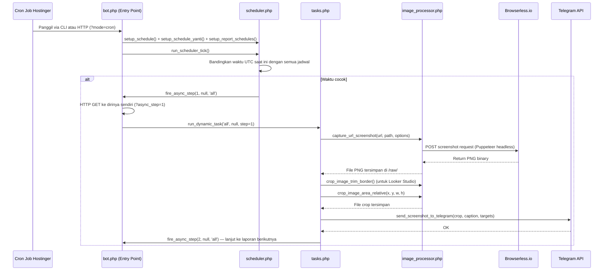
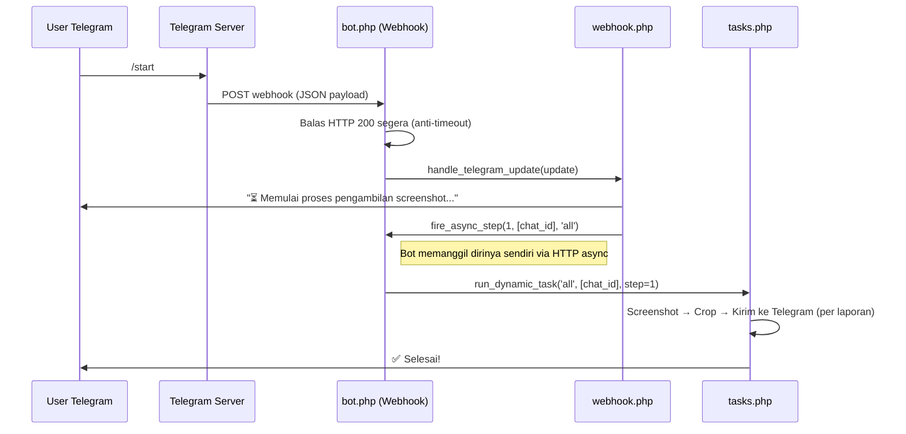
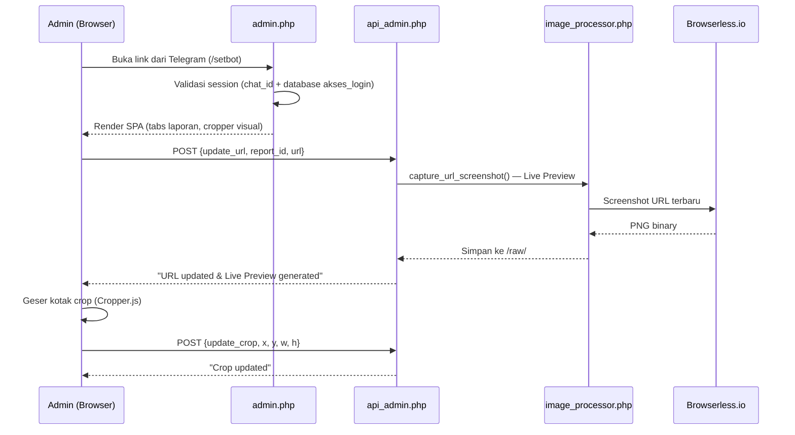

# 🤖 Analisis Lengkap Project "Bot IDAMAN"

## Ringkasan Singkat

**Bot IDAMAN** adalah sebuah **Telegram Bot otomatis** yang berfungsi untuk **mengambil screenshot dashboard/spreadsheet secara terjadwal**, lalu **memotong area tertentu** dari screenshot tersebut, dan **mengirimkannya ke grup Telegram**. Bot ini di-deploy di **Hostinger** dan digunakan oleh tim telekomunikasi (kemungkinan Telkom/IndiHome area **Malang Klojen**) untuk monitoring laporan harian.

---

## 📁 Peta File & Fungsi Setiap File

| File | Fungsi |
|---|---|
| [`bot.php`](file:///c:/Users/MSI/Downloads/idaman/bot.php) | **Entry Point utama** — Router yang menangani 4 mode: CLI Cron, HTTP Cron, Async Step, dan Webhook Telegram |
| [`config.php`](file:///c:/Users/MSI/Downloads/idaman/config.php) | Konfigurasi statis: token Telegram, token Browserless, URL dashboard, Chat ID grup target |
| [`utils.php`](file:///c:/Users/MSI/Downloads/idaman/utils.php) | Utilitas: state management (lock/queue/cancel), logging, konversi waktu WIB↔UTC, async HTTP trigger |
| [`telegram.php`](file:///c:/Users/MSI/Downloads/idaman/telegram.php) | Wrapper API Telegram: kirim pesan teks, kirim foto, inline keyboard |
| [`image_processor.php`](file:///c:/Users/MSI/Downloads/idaman/image_processor.php) | **Mesin Screenshot**: capture via Browserless (Puppeteer), PDF-to-PNG via Imagick, crop gambar (absolut, relatif, auto-trim) |
| [`tasks.php`](file:///c:/Users/MSI/Downloads/idaman/tasks.php) | **Task Engine**: menjalankan screenshot step-by-step secara async, mengelola lock & queue |
| [`scheduler.php`](file:///c:/Users/MSI/Downloads/idaman/scheduler.php) | **Penjadwal internal**: mendaftarkan jadwal dari state & config, menjalankan job yang waktunya cocok |
| [`webhook.php`](file:///c:/Users/MSI/Downloads/idaman/webhook.php) | **Handler perintah Telegram**: /start, /stop, /settime, /deltime, /showtime, /setbot, /help, /imjas, jadwal Yanti |
| [`admin.php`](file:///c:/Users/MSI/Downloads/idaman/admin.php) | **Web Admin Panel** (SPA) — UI visual untuk mengatur laporan, URL, area crop, caption, target grup, jadwal |
| [`api_admin.php`](file:///c:/Users/MSI/Downloads/idaman/api_admin.php) | **Backend API** untuk Admin Panel: CRUD laporan, CRUD crop, update URL + live preview, simpan jadwal |
| [`bot_config.json`](file:///c:/Users/MSI/Downloads/idaman/bot_config.json) | Konfigurasi template default (5 laporan: Ticket Closed, Prov Tsel, Unspec B2C, IMJAS, Unspec Kliring) |
| [`bot_config_live.json`](file:///c:/Users/MSI/Downloads/idaman/bot_config_live.json) | Konfigurasi **aktif/live** yang digunakan bot (dimodifikasi via Web Admin) |
| [`.bot_imjas_state.json`](file:///c:/Users/MSI/Downloads/idaman/.bot_imjas_state.json) | **State persisten**: jadwal aktif, status user (input sedang berlangsung), teks pengingat Yanti |
| [`cek_imagick.php`](file:///c:/Users/MSI/Downloads/idaman/cek_imagick.php) | Script diagnostik: mengecek apakah ekstensi Imagick aktif di server |
| `runtime-bot_imjas.log` | File log runtime (~4.4 MB) |
| `assets/logobotidaman.png` | Logo bot untuk header admin panel |
| `raw/*.png` | Gambar screenshot mentah yang diambil oleh Browserless/Imagick |

---

## 🔄 Alur Kerja (Flow) Utama

### Flow 1: Cron Otomatis (Jadwal Harian)



### Flow 2: Perintah Manual dari Telegram



### Flow 3: Web Admin Panel



---

## ⚙️ Algoritma Kunci

### 1. Async Step-by-Step (Bypass Limit 60 Detik Hostinger)

> **Masalah**: Hostinger membatasi eksekusi PHP maks 60-120 detik. Mengambil screenshot 5 laporan berturut-turut bisa memakan waktu >5 menit.

> **Solusi**: Teknik **self-calling HTTP async**. Setiap laporan diproses dalam 1 "step" HTTP request terpisah.

```
Step 1: Screenshot Ticket Closed → Crop → Kirim → fire_async_step(2)
Step 2: Screenshot Prov Tsel → Crop → Kirim → fire_async_step(3)
Step 3: Screenshot Unspec B2C → Crop → Kirim → fire_async_step(4)
...dst
```

Fungsi [`fire_async_step()`](file:///c:/Users/MSI/Downloads/idaman/utils.php#L195-L217) membuat HTTP GET ke `bot.php?async_step=N` dengan **timeout cURL 3 detik** — artinya ia hanya "menembak" request dan tidak menunggu respons. Server yang menerima request akan [`close_connection_and_continue()`](file:///c:/Users/MSI/Downloads/idaman/utils.php#L220-L240) — memutus koneksi klien lalu melanjutkan proses berat di background.

### 2. Screenshot Engine (Dual-Mode)

```
┌─────────────────────────────────────────────┐
│           capture_url_screenshot()          │
│                                             │
│  URL = Google Sheets?                       │
│    ├─ Ya + Imagick aktif → Solusi 2         │
│    │   (Export PDF → Imagick → PNG)          │
│    │                                         │
│    └─ Tidak → Solusi 1                       │
│        (Browserless.io / Puppeteer SaaS)    │
│        POST JSON → Terima PNG binary        │
└─────────────────────────────────────────────┘
```

- **Solusi 1** — [Browserless.io](file:///c:/Users/MSI/Downloads/idaman/image_processor.php#L84-L199): Mengirim URL ke layanan cloud Puppeteer, menunggu halaman load (10-24 detik delay), lalu terima screenshot PNG. Viewport diatur 1920x1200 (Sheets) atau 1920x2500 (Looker Studio) dengan `deviceScaleFactor: 2` untuk ketajaman tinggi.

- **Solusi 2** — [PDF-to-PNG via Imagick](file:///c:/Users/MSI/Downloads/idaman/image_processor.php#L9-L82): Khusus Google Sheets. Mengeksport spreadsheet sebagai PDF melalui URL export native Google (`/export?format=pdf&gid=...`), lalu mengkonversi halaman pertama PDF ke PNG menggunakan Imagick dengan resolusi 300 DPI. **Ini lebih cepat dan gratis** dibanding Browserless.

### 3. Image Cropping (3 Metode)

| Metode | Fungsi | Deskripsi |
|---|---|---|
| Crop Relatif | [`crop_image_area_relative()`](file:///c:/Users/MSI/Downloads/idaman/image_processor.php#L310-L332) | Memotong berdasarkan **persentase** (0.0–1.0) dari ukuran gambar. Digunakan oleh Task Engine |
| Crop Absolut | [`crop_image_area()`](file:///c:/Users/MSI/Downloads/idaman/image_processor.php#L201-L240) | Memotong berdasarkan piksel absolut (left, top, width, height) |
| Auto-Trim | [`crop_image_trim_border()`](file:///c:/Users/MSI/Downloads/idaman/image_processor.php#L242-L308) | **Algoritma cerdas**: mendeteksi warna background (piksel [0,0]) lalu memangkas border kosong dari 4 sisi. Menggunakan sampling setiap 3 piksel untuk efisiensi |

### 4. Task Locking & Queue System

```
┌────────────────────────────────────────────────────┐
│  Request masuk (/start atau Cron)                  │
│                                                    │
│  Lock file ada (.bot_imjas_running.lock)?           │
│    ├─ Ya & belum expired (TTL 300s):               │
│    │   → Masukkan ke antrean                       │
│    │     (.bot_imjas_queue.txt untuk /start,        │
│    │      .bot_imjas_group_queue.txt untuk cron)   │
│    │                                               │
│    └─ Tidak:                                       │
│        → Set lock → Jalankan task                  │
│        → Setelah selesai, clear lock               │
│        → Cek antrean, jalankan task berikutnya     │
└────────────────────────────────────────────────────┘
```

### 5. Scheduler Internal

Bukan cron Linux biasa — ini **pseudo-cron** yang berjalan setiap menit via cron job Hostinger yang memanggil `bot.php`:

1. Setiap dipanggil, scheduler **mendaftarkan semua jadwal** dari 3 sumber:
   - `$schedules_data` (jadwal global dari state)
   - `$schedules_yanti` (jadwal pengingat Yanti)
   - Config laporan (`bot_config_live.json` → field `schedules`)
2. Membandingkan **jam:menit UTC saat ini** dengan semua jadwal
3. Jika cocok → `fire_async_step()` untuk memulai task

---

## 🗂️ Laporan yang Dimonitor

Berdasarkan [`bot_config_live.json`](file:///c:/Users/MSI/Downloads/idaman/bot_config_live.json):

| ID | Nama | Sumber | Grup |
|---|---|---|---|
| `ticket_closed` | Ticket Closed Malang | Looker Studio | main |
| `prov_tsel` | Dashboard Prov Tsel | Looker Studio | main |
| `unspec_b2c` | Unspec B2C Klojen | Google Sheets | main |
| `imjas_malang` | IMJAS Malang | Google Sheets | imjas_kliring |

Setiap laporan bisa punya **beberapa area crop** (misalnya `ticket_closed` punya "Tabel Utama" dan "PBS Bulanan"), masing-masing dikirim sebagai foto terpisah ke grup Telegram yang berbeda.

---

## 📱 Perintah Telegram yang Tersedia

| Perintah | Fungsi |
|---|---|
| `/start` | Jalankan screenshot **semua** laporan sekarang juga |
| `/imjas` | Jalankan screenshot hanya grup IMJAS & Kliring |
| `/stop` | Hentikan proses screenshot yang sedang berjalan |
| `/showtime` | Tampilkan semua jadwal (aktif & nonaktif) |
| `/settime` | Ubah/tambah jadwal screenshot otomatis |
| `/deltime` | Hapus/nonaktifkan jadwal |
| `/setbot` | Buka Web Admin Panel (validasi admin via database) |
| `/help` | Tampilkan panduan |
| `/set-yanti` | Atur jadwal pengingat untuk Mba Yanti |
| `/show-yanti` | Lihat jadwal pengingat Yanti |
| `/delete-yanti` | Hapus jadwal pengingat Yanti |
| `/set-yanti-text` | Ubah teks pesan pengingat Yanti |
| `/show-yanti-text` | Lihat teks pengingat Yanti saat ini |

---

## 🌐 Web Admin Panel

[`admin.php`](file:///c:/Users/MSI/Downloads/idaman/admin.php) adalah **Single Page Application** yang memungkinkan admin:

1. **Menambah/menghapus/edit laporan** (tab dinamis)
2. **Mengubah URL** sumber data + **live preview** (screenshot langsung dari Browserless)
3. **Mengatur area crop** secara visual menggunakan **Cropper.js** — drag & resize kotak biru di atas gambar
4. **Mengatur caption, nama crop, dan grup target** untuk setiap area crop
5. **Mengatur jadwal khusus per-laporan** (opsional, pisah dari jadwal global)

**Autentikasi**: Link admin didapat melalui `/setbot` di Telegram → bot mengecek `chat_id` di tabel database `akses_login` (MySQL di Hostinger) → jika valid, redirect ke admin panel dengan session.

---

## 🏗️ Arsitektur Deployment

```
Hostinger Shared Hosting (LiteSpeed + PHP)
├── Cron Job: Setiap menit → GET bot.php?mode=cron
├── Webhook Telegram: POST ke bot.php (via setWebhook API)
├── Web Admin: admin.php + api_admin.php
├── Database: MySQL (u408986314_klkfoo) — tabel akses_login
└── External Services:
    ├── Browserless.io (Screenshot-as-a-Service, Puppeteer cloud)
    ├── Telegram Bot API
    ├── Google Looker Studio (dashboard source)
    └── Google Sheets (spreadsheet source)
```

---

## 🔑 Insight Penting

> [!IMPORTANT]
> **Ini bukan bot biasa.** Ini adalah sistem **monitoring visual otomatis** untuk tim telekomunikasi (Telkom/IndiHome area Malang Klojen) yang mengkonversi dashboard & spreadsheet menjadi gambar dan mengirimkannya ke grup Telegram secara berkala — memungkinkan tim melihat status laporan tanpa harus membuka dashboard secara manual.

> [!WARNING]
> **Token API (Telegram & Browserless) terekspos** langsung di source code [`config.php`](file:///c:/Users/MSI/Downloads/idaman/config.php#L10-L14). Ini adalah risiko keamanan jika repository dipublikasikan.

> [!NOTE]
> **Jadwal aktif saat ini** (dari [`.bot_imjas_state.json`](file:///c:/Users/MSI/Downloads/idaman/.bot_imjas_state.json)):
> - 02:59 UTC (09:59 WIB), 05:59 UTC (12:59 WIB), 09:59 UTC (16:59 WIB), 11:59 UTC (18:59 WIB), 14:59 UTC (21:59 WIB)
> - IMJAS Malang punya jadwal khusus sendiri: **10:03 WIB**
> - Pengingat Yanti: 02:59, 05:59, 07:59, 11:59 UTC (tapi `ENABLE_YANTI_REMINDER = false`, jadi sedang nonaktif)
